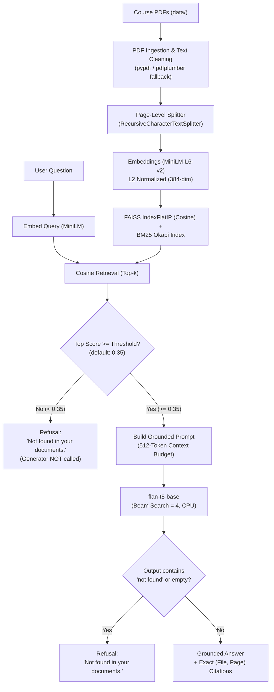

# BuBot: Local, Grounded Course PDF Q&A RAG Chatbot

BuBot is a free, local, open-source Retrieval-Augmented Generation (RAG) chatbot developed as a B.Tech AI/ML project. BuBot answers academic queries strictly using the student's lecture slides and course PDFs, cites the exact file and 1-indexed page number for every answer, and enforces threshold-based rejection (`"Not found in your documents."`) whenever the course material does not answer the question.

After models are pre-downloaded, the entire ingestion, indexing, retrieval, and generation pipeline runs **100% offline on a standard laptop CPU with 8 GB RAM** without any cloud APIs, external tokens, or subscription costs.

---

## Architecture Overview



---

## Project Structure

```text
BuBot/
├── data/                             # Course PDFs (drop lecture notes here)
│   └── sample_course_notes.pdf       # Multi-page sample ML course notes
├── index_store/                      # Persisted vector and keyword indices (gitignored)
│   ├── faiss.index                   # FAISS IndexFlatIP binary
│   ├── chunks.jsonl                  # Chunk texts and exact citation metadata
│   ├── bm25.pkl                      # BM25Okapi tokenized corpus
│   └── meta.json                     # Index fingerprint, config snapshot, timestamp
├── src/
│   ├── __init__.py
│   ├── config.py                     # All tunable constants, paths, and hyperparameters
│   ├── ingest.py                     # PDF text extraction, cleaning, and page-level chunking
│   ├── index.py                      # Embedding generation, FAISS & BM25 index builder/loader
│   ├── rag.py                        # BuBot core class, strict refusal, prompt, generator, CLI
│   ├── baselines.py                  # BM25Retriever & NoRetrievalBaseline
│   ├── download_models.py            # Pre-download utility for 100% offline execution
│   └── finetune_embeddings.py        # Optional sentence-transformers fine-tuning module
├── eval/
│   ├── questions.csv                 # 30 in-scope + 10 out-of-scope evaluation questions
│   ├── make_question_template.py     # Template generator and CSV validator
│   ├── run_eval.py                   # Metric evaluation harness (Hit@k, Refusal, Proxy F1)
│   ├── run_experiments.py            # Empirical comparison sweeps & matplotlib chart generator
│   ├── grade_answers.py              # Interactive terminal grading CLI for human evaluation
│   └── results/                      # Evaluation run CSVs, JSON summaries, and PNG charts
├── tests/
│   ├── __init__.py
│   ├── conftest.py                   # Pytest fixtures and programmatic mock PDF generator
│   ├── test_ingest.py                # Ingestion, 1-indexed pages, hyphenation, corruption tests
│   ├── test_index.py                 # Index round-trip, cosine score range, stale check tests
│   ├── test_rag.py                   # Strict refusal, generator skipping, prompt budget tests
│   └── test_eval.py                  # Hit rate, refusal rate, F1 proxy unit tests
├── scripts/
│   └── create_sample_pdf.py          # Script to generate sample ML course PDF
├── requirements.txt                  # Pinned Python dependencies
├── README.md                         # Documentation and setup guide
└── .gitignore                        # Git ignore patterns
```

---

## Installation & Setup

### 1. Prerequisites
- Python 3.10+ (tested on Python 3.10, 3.11, 3.12)
- Windows, macOS, or Linux
- Minimum 8 GB RAM (runs on CPU)

### 2. Environment Setup
Create and activate a virtual environment:

```bash
# Windows
python -m venv .venv
.venv\Scripts\activate

# Linux / macOS
python3 -m venv .venv
source .venv/bin/activate
```

Install pinned dependencies:
```bash
pip install -r requirements.txt
```

### 3. Pre-Download Models (One-Time Setup)
To guarantee 100% offline operation without network calls during runtime:

```bash
python -m src.download_models
```

This caches `sentence-transformers/all-MiniLM-L6-v2` (~90 MB) and `google/flan-t5-base` (~990 MB) locally in your HuggingFace cache directory.

---

## End-to-End Workflow

### Step 1: Ingest and Preview Chunks
Place your course lecture PDFs into the `data/` directory, then preview chunk quality:

```bash
python -m src.ingest --preview 10
```
This parses the PDFs, cleans repetitive headers/footers, repairs hyphenated line breaks, chunks text strictly per page, and displays 10 random sample chunks with file names, 1-indexed page numbers, and lengths.

### Step 2: Build or Rebuild the Index
Build the FAISS vector index and BM25 keyword index:

```bash
python -m src.index --rebuild
```
This embeds all chunks with progress bars, L2-normalizes the vectors, builds the FAISS `IndexFlatIP` index, constructs the BM25 index, and saves artifacts to `index_store/`.

### Step 3: Query BuBot via CLI
Ask questions directly from the command line:

```bash
# In-scope question (answered with exact file and page citations)
python -m src.rag "What is backpropagation?"

# In-scope question on regularizations
python -m src.rag "How does L1 regularization differ from L2 regularization?"

# Out-of-scope question (strictly refused without calling generator)
python -m src.rag "Who won the 2018 FIFA World Cup?"
```

Sample CLI output:
```text
======================================================================
BUBOT RESPONSE
======================================================================
Question:    What is backpropagation?
Answer:      Backpropagation is the fundamental algorithm used to calculate gradients of the loss function with respect to network weights.
Refused:     False (Grounded: True)
Top Score:   0.8124 (Threshold: 0.3500)
Latency:     1.2405s [retrieval: 0.0410s, generation: 1.1995s]

Sources Retrieved:
  [1] sample_course_notes.pdf (Page 3) | Score: 0.8124 | ID: sample_course_notes.pdf::p3::c0
      Text: "Lecture 3: Backpropagation and Training Backpropagation is the fundamental algorithm used to calculate gradients of the loss function with respect to network weights..."
======================================================================
```

---

## Evaluation & Experiments

### 1. Prepare Question Benchmark
BuBot includes a 40-question benchmark (30 in-scope course questions + 10 out-of-scope trivia questions):

```bash
python -m eval.make_question_template
```
This samples 30 diverse chunks from your indexed course notes into `eval/questions.csv` with a `source_chunk` helper column so you can formulate questions and ground-truth answers based on your course material. 10 out-of-scope trivia questions are pre-filled.

### 2. Run Evaluation Suite
```bash
python -m eval.run_eval --k 3 --threshold 0.35
```
Calculates and reports:
- **Hit@k (Strict)**: Percentage of in-scope questions where top-k chunks match expected file and exact page.
- **Hit@k (Lenient page ± 1)**: Lenient match allowing adjacent page margin.
- **Refusal Rate (Out-of-Scope)**: Fraction of out-of-scope questions correctly rejected.
- **False Refusal Rate (In-Scope)**: Fraction of in-scope questions mistakenly rejected due to threshold.
- **Answer Accuracy (Manual Official)**: Human-graded accuracy (Correct=1.0, Partial=0.5, Wrong=0.0).
- **Answer Accuracy (Token F1 Proxy)**: SQuAD-style token F1 overlap proxy.
- **Latency**: Mean, median, and p95 latency broken down by retrieval and generation.
Outputs are saved to `eval/results/run_<timestamp>.csv` and `.json`.

### 3. Interactive Manual Grading
Walk through the model answers and assign grades:

```bash
python -m eval.grade_answers
```
Keys: `c` (correct), `p` (partial), `w` (wrong), `s` (skip), `q` (save & quit). Fully resumable.

### 4. Run Empirical Experiments & Sweeps
Run comparative ablation studies and generate charts:

```bash
python -m eval.run_experiments
```
Sweeps executed:
1. **Dense Retrieval (MiniLM) vs BM25 Keyword**: Compares Hit@3.
2. **Full RAG vs No-Retrieval Baseline**: Demonstrates hallucination vs refusal on out-of-scope queries.
3. **Chunk Size Sweep**: Evaluates chunk sizes 300 vs 500 vs 800 in isolated temporary indices.
4. **k Sweep**: Evaluates k = 2, 3, 5 for hit rate, latency, and proxy F1.
5. **Threshold Sweep**: Evaluates thresholds from 0.20 to 0.60 in steps of 0.05, plots trade-off curve, and computes the mathematically optimal recommended threshold maximizing `(OOS Refusal - In-Scope False Refusal)`.
Artifacts saved in `eval/results/`:
- `experiment_summary.csv`
- `threshold_sweep.csv`
- `experiment_hit_rates.png`
- `threshold_tradeoff.png`

---

## Optional Extension: Embedding Fine-Tuning

BuBot supports domain-adaptive fine-tuning of `all-MiniLM-L6-v2` using `MultipleNegativesRankingLoss`:

```bash
# Synthetic mode (generates pairs using flan-t5, clearly marked as synthetic)
python -m src.finetune_embeddings --mode synthetic --epochs 2

# Or student-supplied hand-written pairs CSV
python -m src.finetune_embeddings --mode csv --pairs-file path/to/pairs.csv --epochs 2
```
Splits pairs 80/20 by chunk (zero leakage) and records Hit@3 before vs after fine-tuning in `eval/results/finetune_comparison.csv`.

---

## Running Automated Tests

All tests are self-contained, generate programmatic mock PDFs, and run offline without network access:

```bash
pytest
```
To run specific test modules:
```bash
pytest tests/test_ingest.py
pytest tests/test_index.py
pytest tests/test_rag.py
pytest tests/test_eval.py
```

---

## Configuration Reference (`src/config.py`)

All constants, paths, and hyperparameters live in `src/config.py` and can be customized via environment variables:

| Variable | Default Value | Env Variable | Description |
| :--- | :--- | :--- | :--- |
| `DATA_DIR` | `data/` | `BUBOT_DATA_DIR` | Directory containing course PDFs |
| `INDEX_DIR` | `index_store/` | `BUBOT_INDEX_DIR` | Directory storing FAISS and BM25 index files |
| `RESULTS_DIR` | `eval/results/` | `BUBOT_RESULTS_DIR` | Directory for evaluation CSVs and charts |
| `EMBED_MODEL` | `sentence-transformers/all-MiniLM-L6-v2` | `BUBOT_EMBED_MODEL` | Embedding model (384-dim) |
| `FALLBACK_EMBED_MODEL` | `BAAI/bge-small-en-v1.5` | `BUBOT_FALLBACK_EMBED_MODEL` | Fallback embedding model |
| `GEN_MODEL` | `google/flan-t5-base` | `BUBOT_GEN_MODEL` | Generation model (`flan-t5-small`, `flan-t5-large` also supported) |
| `CHUNK_SIZE` | `500` | `BUBOT_CHUNK_SIZE` | Recursive character chunk size (characters) |
| `CHUNK_OVERLAP` | `50` | `BUBOT_CHUNK_OVERLAP` | Character overlap between chunks on same page |
| `MIN_CHUNK_CHARS` | `30` | `BUBOT_MIN_CHUNK_CHARS` | Minimum character length for valid chunks |
| `MIN_PAGE_CHARS` | `20` | `BUBOT_MIN_PAGE_CHARS` | Fallback threshold for empty/scanned pages |
| `TOP_K` | `3` | `BUBOT_TOP_K` | Default number of retrieved chunks |
| `SIM_THRESHOLD` | `0.35` | `BUBOT_SIM_THRESHOLD` | Cosine similarity refusal threshold |
| `MAX_INPUT_TOKENS` | `512` | `BUBOT_MAX_INPUT_TOKENS` | Prompt context token budget |
| `MAX_NEW_TOKENS` | `128` | `BUBOT_MAX_NEW_TOKENS` | Max generation tokens |
| `GEN_NUM_BEAMS` | `4` | `BUBOT_GEN_NUM_BEAMS` | Beam search count for generation |
| `NOT_FOUND_MESSAGE` | `"Not found in your documents."` | `BUBOT_NOT_FOUND_MESSAGE` | Canonical refusal string |
| `ANSWER_STYLE` | `"standard"` | `BUBOT_ANSWER_STYLE` | Set to `"extractive_fallback"` for concise answer evidence |
| `USE_OCR` | `False` | `BUBOT_USE_OCR` | Enable OCR fallback for scanned PDFs |

---

## UI Contract for Streamlit Integration

When connecting the Streamlit frontend (`app.py`), use the exposed backend contract without modifying `src/`:

```python
from src.rag import BuBot, Answer, RetrievedChunk

# 1. Initialize backend once (wrap in @st.cache_resource)
bot = BuBot()

# 2. Query BuBot
answer: Answer = bot.answer(user_question)
# answer.answer_text -> str
# answer.refused     -> bool
# answer.top_score   -> float
# answer.sources     -> list[RetrievedChunk]
# answer.latency_s   -> float

# 3. Sidebar sliders & controls
bot.set_threshold(selected_threshold)
bot.set_top_k(selected_k)

# 4. Sidebar metadata
info = bot.index_info()
# info["files"], info["num_chunks"], info["threshold"], info["top_k"]

# 5. Hot-swap index when user uploads PDFs
bot.rebuild_index(uploaded_pdf_paths)
```

---

## Troubleshooting & Fallbacks

- **Garbled or Scanned PDF**:
  If a PDF page yields fewer than 20 characters, `src/ingest.py` automatically falls back to `pdfplumber`. If the page remains empty, a warning is logged indicating the page is likely a scanned image. You can enable OCR by setting `BUBOT_USE_OCR=true` (requires `pytesseract` and `poppler`).
- **Slow CPU Inference**:
  - Swap generation model to `google/flan-t5-small` in `src/config.py` or set `BUBOT_GEN_MODEL="google/flan-t5-small"`.
  - Decrease `TOP_K` from 3 to 2.
- **Short or Terse Answers**:
  - Set `ANSWER_STYLE = "extractive_fallback"` in `src/config.py`. If the model output is under 3 words, the best matching evidence sentence from the top retrieved chunk is surfaced in `evidence_sentence`.
  - Swap to `google/flan-t5-large` or configure the optional `BUBOT_REMOTE_GEN_URL` hook to run generation on Google Colab GPU.
- **Stale Index Warning**:
  If PDF notes are added, removed, or chunk hyperparameters are modified, `load_index()` detects the hash mismatch and logs a warning. Run `python -m src.index --rebuild` to synchronize.

